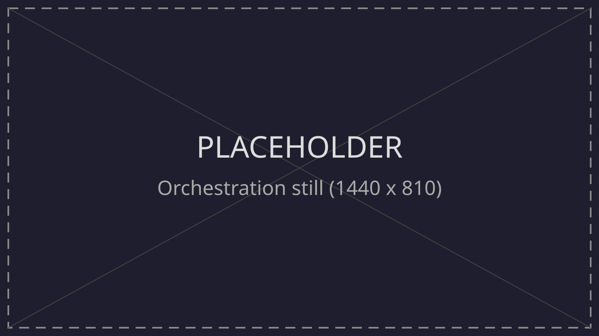

<!--markpress-opt
{
  "autoSplit": false,
  "sanitize": false,
  "title": "Building an Agent-Friendly Repository"
}
markpress-opt-->

<!--slide-attr x=0 y=0 scale=1.2 -->

# Building an Agent-Friendly Repository
## Small optimizations that make a coding agent work better in your repository

Your Name · Event Name · 2026

<!-- SPEAKER NOTES
Open by clarifying the scope: this is a specific, practical topic. A coding agent already works in a standard repository without special setup. These optimizations simply help it work more effectively and smoothly.
Audience: students and early-career engineers who have used coding agents and watched them fail in ways that were hard to explain.
Format: lecture, no live demo, no exercise. Nothing needs to be installed to follow along. The setup is presented so you can replicate it later.
Out of scope: model choice and prompt engineering techniques. The model is held fixed throughout the talk.
Harness: examples use Copilot in VS Code. Hook names and skill frontmatter follow Copilot conventions; other harnesses have equivalent concepts under different names.
-->

------

<!--slide-attr x=3600 y=0 rotate=2 scale=1.0 -->

# Common "Friction Points" When Using Agents

- Code looks correct at a glance, but breaks during deployment or with real users
- Edits in generated files, `.env` files, or unrelated parts of the codebase
- The session needs constant human steering to stay on track
- Long sessions where most of the time is spent searching and guessing commands
- Token spend out of proportion to the size of the change
- Review and repair time that cancels out the time the agent saved

<!-- SPEAKER NOTES
Start by acknowledging what the audience may be wondering: the agent already works in a standard repository without fancy setup. It reads files, runs commands, edits code, and reports back; for a small local change, it often succeeds. Nothing in this talk is a prerequisite for the agent to run. A default repository is not a broken repository.
So the question is not "will it run". The question is how much of the agent's effort is wasted figuring out things the repository already knows. Today's topic is friction and wasted resources, not model capability.
Agent failure is rarely an overt crash. It happens much more quietly, and every bullet point here is an experience most people in the room have run into.
Two published studies provide relevant context: a repository-maintained AGENTS.md is associated with lower token usage and shorter sessions (Lulla et al., 2026). In contrast, auto-generated context files did not improve success rates and increased costs (Gloaguen et al., 2026).
Be explicit: neither study measures these exact failure modes, and neither was run on your specific repository. They provide reference context, not a local reproduction.
-->

------

<!--slide-attr x=5400 y=0 rotate=-1 scale=1.0 -->

# Why Does This Friction Happen?

At the start of a session, the agent has no mental model of your repository.

- Build command not stated: the agent guesses, and guesses again
- Feedback loop too slow: the agent iterates without knowing if it is on track
- Conventions not stated: the agent copies the nearest example
- Boundaries not stated: nothing stops the agent from editing sensitive files or running the wrong commands
- Knowledge outside the repository: the agent is completely blind to it

> Every unanswered question becomes an inference by the agent.
> Inferences cost tokens, time, and correctness.

<!-- SPEAKER NOTES
A new teammate accumulates understanding week by week. An agent starts fresh: entering a session, it only has instructions, conversation history, and tools — nothing else in its head. Everything it needs must come from files in the repository, from the conversation, or through tool calls.
Walk through the five bullets: each is essentially a question the model must answer by guessing when the repository does not make it clear.
This is the core mechanism that the rest of the talk builds on. This argument is derived from how agents operate and verified through hands-on observation, not theoretical assumptions.
-->

------

<!--slide-attr x=7200 y=0 rotate=2 scale=1.0 -->

# Optimize the Working Environment, Not the Model

- Does not make the model smarter, but frees it from repetitive guesswork
- The model becomes far more effective when operating in an "ideal" environment

<!-- SPEAKER NOTES
The model is the same before and after. The only thing that changes is how much of its "budget" (tokens and attention) is spent figuring out the repository versus actually completing the task.
This talk is not about switching to a better model or learning prompt hacks — both matter, but neither is today's focus. We also do not claim that configuration alone guarantees the agent will always be correct. This is not a formal measurement study, nor a mandatory checklist to install everything. Several areas are situational, and some are entirely optional.
-->

------

<!--slide-attr x=1800 y=1300 rotate=-2 scale=1.0 -->

# Techniques to Optimize the Agent Environment

| Area | When to apply |
|---|---|
| AGENTS.md | When the agent guesses commands or conventions |
| Scripts | When a workflow or procedure repeats |
| Skills | When a procedure repeats and requires detailed step-by-step guidance |
| Hooks | When the agent risks modifying protected or sensitive areas |
| MCP | When required information lives outside the checkout |
| Orchestration | When review, not code generation, is the bottleneck |

<!-- SPEAKER NOTES
This is a map from common friction points to solution areas, along with triggers for when to implement each. There is no mandatory order.
They layer logically: AGENTS.md states the answers; scripts automate those actions; skills package the full workflow; and hooks enforce technical guardrails. Layering explains how the components fit together, not an order of operations.
The first four areas are files contained entirely within the checkout. MCP is a service server paired with client-side configuration. Orchestration is the tooling humans use to coordinate multiple agents, without modifying repository code. We will clarify this as we delve into each area.
-->

------

<!--slide-attr x=3600 y=1300 rotate=2 scale=1.0 -->

# AGENTS.md

<!-- SPEAKER NOTES
A short, hand-written file: commands, concise layout, conventions, boundaries, and definition of done.
Point out specific lines in the file and the agent's corresponding actions in the session.
Context cost: loaded in every session, so keep it concise or the token cost outweighs the benefit.
Crucial advice: write it by hand. Auto-generating context files often inflates costs without improving success. Leave out README copies, long architectural essays, secrets, and auto-generated summaries.
-->

------

<!--slide-attr x=7200 y=1300 rotate=2 scale=1.0 -->

# Scripts

- One clear command per intent: `setup`, `verify`, `test-one <path>`, `reproduce <issue>`
- Non-interactive, predictable exit codes, bounded output, fail-fast
- Support `--json` flag when structured data helps, disable color when not a TTY

<!-- SPEAKER NOTES
Scripts reduce rounds of trial and error discovering how to run things, eliminating long sessions dominated by failed commands.
Context cost is very low. The agent only needs to know the command name, which is clearly listed in AGENTS.md. However, script output enters the session context directly, making bounded output crucial.
You will see the value of scripts the moment any workflow begins to repeat.
-->

------

<!--slide-attr x=0 y=2600 rotate=-1 scale=1.0 -->

# Skills

- Package repeated workflows into dedicated directories with a `SKILL.md` file
- Progressive loading: read name and description first, load full body only on demand
- Keep templates and fixtures in separate files
- Thoroughly test each skill against tasks the agent has not seen before
- Do not package one-offs

<!-- SPEAKER NOTES
Skills prevent inconsistent execution of workflows that run smoothly when humans remember every step, but get missed or altered by agents.
Context cost is low thanks to progressive loading: the agent skims name and description first; only when relevant to the task does it load the detailed body into the session.
Only package a skill when the same procedure repeats across multiple tasks and requires detailed steps. If simple, a single line in AGENTS.md or a script is plenty.
-->

------

<!--slide-attr x=1800 y=2600 rotate=2 scale=1.0 -->

# Hooks

- Commands triggered automatically by harness events, independent of the model
- Event lifecycle in Copilot: `preToolUse`, `postToolUse`, `sessionStart`, `sessionEnd`
- Start gently with an audit hook: log invoked tool names only
- Once data is gathered, enforce guardrails on sensitive paths or error-prone commands

<!-- SPEAKER NOTES
Hooks prevent errors that written instructions fail to stop — such as editing protected paths or committing unformatted files.
Hooks are the only repository mechanism that does not depend on whether the model reads or complies with instructions. We cannot delegate safety boundaries to the model's self-discipline.
Context cost is very low: hooks run entirely outside the model, but when an action is blocked, feedback is routed back to the model so it can self-correct.
A common anti-pattern to avoid: hooks that over-block everything, or hooks that fail silently without explaining why.
-->

------

<!--slide-attr x=3600 y=2600 rotate=-2 scale=1.0 -->

# MCP

- Run servers providing data the checkout lacks: issues, CI logs, databases
- Highest context cost of all areas: tool schemas and outputs both enter the session
- Always prefer local scripts whenever a script can do the job
- Verify the tool is actually invoked by the agent before keeping the server around

<!-- SPEAKER NOTES
MCP reduces guesswork about context and business data outside the repository checkout.
However, if the answer does not strictly live outside the checkout, adding an MCP server merely burns token budget without delivering real value.
-->

------

<!--slide-attr x=5400 y=2600 rotate=1 scale=1.0 -->

# Orchestration

- Tooling to help engineers steer and manage multiple agents concurrently
- Does not modify the repository: all code in the checkout remains unchanged
- Cost is human attention, not model context
- Leverage Git worktrees: each parallel task gets an isolated checkout, port, and database
- Scale to multiple sessions only after a single-session run reliably passes `verify`

<!-- SPEAKER NOTES
Orchestration prevents "blind reviews" when running multiple sessions simultaneously. It is only worth investing in when your bottleneck is code review, not code generation.
It acts as an amplifier: whatever strengths or weaknesses your repository has, orchestration multiplies them. The Agents view shown is currently in Preview in VS Code, presented for your future reference. Other harnesses follow similar patterns under different names.
Custom agents and subagents define specialized roles: planner, implementer, reviewer, researcher. Review and research agents should strictly receive read-only tools.
Two critical reminders: worktree sessions often operate with broad permissions, making sandboxing and guardrail hooks even more essential. If multiple sessions report "done" while tests fail en masse, the problem lies in the repository setup, not the model.
-->

------

<!--slide-attr x=7200 y=3900 rotate=2 scale=1.0 -->

# Common Anti-Patterns

- Installing every tool before knowing where the actual friction lies
- Auto-generating an `AGENTS.md` file and never reviewing it
- Writing overly long instruction files that duplicate existing documentation
- Writing hooks that over-block everything or fail silently without explanation
- Adding MCP servers on a hunch that "we might need it later"

<!-- SPEAKER NOTES
The five items on the slide are the most common real-world pitfalls; others are detailed in the accompanying handout: obsessing over token counts without checking code correctness, adding tools without verifying they get invoked, running parallel agents without port and dependency isolation, rushing into orchestration before single-agent runs are stable, setting up dashboards without acting on data, or assuming a config file means a capability works reliably.
-->

------

<!--slide-attr x=0 y=5200 rotate=-1 scale=1.0 -->

# DevEx: From Developers to Coding Agents

| Improvement | Value for Humans | Value for Coding Agents |
|---|---|---|
| Clear docs & onboarding | Fast onboarding, less asking teammates | Tacit knowledge becomes runtime input (`AGENTS.md`, `skills`) |
| Standard scripts & automation | Less manual effort, fewer typing mistakes | Deterministic non-interactive interface (`scripts`, `MCP`) |
| Fast feedback loops | Fast local tests & CI, maintains flow | Fast verification, fail-fast guidance without token waste |
| Reduced cognitive load | Focus on core logic, less mental clutter | Compact context window, avoids context rot and guesswork |
| Guardrails & boundaries | Linters and team conventions prevent bad commits | Automated hooks enforce rules without relying on model compliance |
| Isolated environments | Parallel branch work without port/DB collision | Safe concurrent multi-agent runs via Git worktrees |

<!-- SPEAKER NOTES
DevEx is not just for humans. Every effort spent making the repository easier for engineers — writing clear docs, standardizing scripts, speeding up tests, lowering cognitive load, adding guardrails, and isolating environments — maps directly to optimizing the environment for coding agents.
The core difference: Humans accumulate tacit knowledge over time, while agents start each session blind. A repository with great DevEx for humans provides the exact foundation an agent needs to perform well.
-->

------

<!--slide-attr x=1800 y=5200 rotate=2 scale=1.0 -->

# Take Aways

- The agent already works; the repository determines how effectively
- Optimize one step at a time, intervening only when encountering real-world friction
- After optimizing the environment, keep monitoring and refining for future runs

> A developer learns the setup once.
> An agent pays for it in tokens and time in every session.

<!-- SPEAKER NOTES
Summing up with the core thesis and its boundary: holding the model and task fixed, changing the repository directly changes how the agent performs. This is grounded in how LLMs actually operate. Your everyday working sessions are the ultimate verification.
If sessions in your own repository do not become smoother or more effective after a change, that solution was simply not the right fit for your repository.
-->

------

<!--slide-attr x=3600 y=5200 rotate=-2 scale=1.0 -->

# References

- Lulla et al., [On the Impact of AGENTS.md Files on the Efficiency of AI Coding Agents](https://arxiv.org/html/2601.20404v2)
- Gloaguen et al., [Evaluating AGENTS.md](https://arxiv.org/abs/2602.11988)
- [How Do AI Agents Spend Your Money?](https://arxiv.org/html/2604.22750v3)
- METR, [Measuring the Impact of Early-2025 AI on Experienced Developer Productivity](https://metr.org/blog/2025-07-10-early-2025-ai-experienced-os-dev-study)
- Google Cloud, [DORA 2024 report](https://cloud.google.com/blog/products/devops-sre/announcing-the-2024-dora-report)
- Spotify, [Coding Is No Longer the Constraint](https://engineering.atspotify.com/2026/6/code-with-claude-coding-is-no-longer-the-constraint)
- Modal, [Agents need good developer experience too](https://modal.com/blog/agents-devex)
- incident.io, [DevEx matters for coding agents, too](https://incident.io/blog/ai-developer-tools)

<!-- SPEAKER NOTES
Notable research papers and engineering analyses from teams at Spotify, Modal, incident.io, and AI research organizations. Follow the links directly on the slide to read the original publications.
-->

------

<!--slide-attr x=5400 y=5200 rotate=1 scale=1.1 -->

# Thank You for Listening!

| GitHub | Website |
|---|---|
|  |  |
|  |  |

<!-- SPEAKER NOTES
Ten minutes for Q&A and discussion. Common questions include: how to measure concrete outcomes, how to adapt patterns to harnesses other than Copilot, and when the context cost of an MCP server is genuinely worthwhile.
-->
